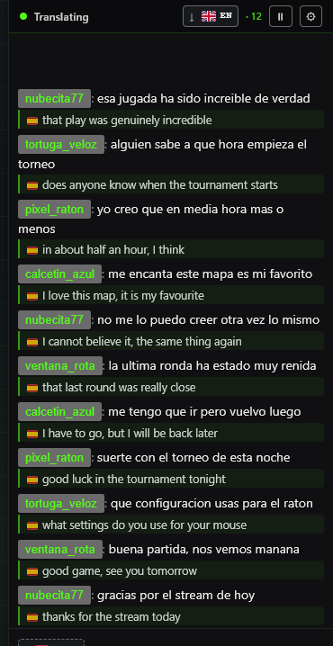
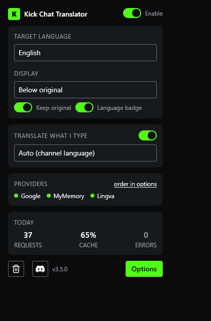
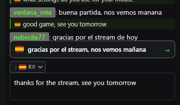
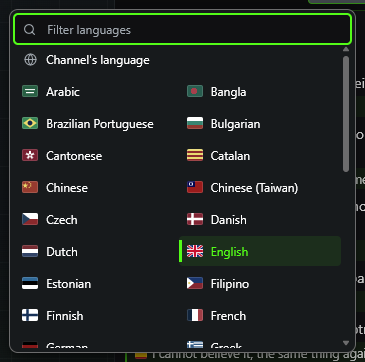

<div align="center">


# Kick Chat Translator

Read any Kick chat in your own language, and reply in the channel's.<br>
Free, no account, nothing to set up. 43 languages, in the chat and in the extension itself.

**[Add to Chrome, Brave or Edge](https://chromewebstore.google.com/detail/kick-chat-translator/nkkjmbkmacbdkboijmnhjnblcaiclhni)** &nbsp;·&nbsp; **[Add to Firefox](https://addons.mozilla.org/firefox/addon/kick-chat-translator/)** &nbsp;·&nbsp; [Discord](https://discord.gg/udDzxQRyQ9)

[](https://chromewebstore.google.com/detail/kick-chat-translator/nkkjmbkmacbdkboijmnhjnblcaiclhni)
[](https://chromewebstore.google.com/detail/kick-chat-translator/nkkjmbkmacbdkboijmnhjnblcaiclhni)
[](https://addons.mozilla.org/firefox/addon/kick-chat-translator/)
[](https://github.com/kilworks/kick-chat-translator/actions/workflows/ci.yml)
[](LICENSE)

[Français](README.fr.md) · [Español](README.es.md) · [Português (Portugal)](README.pt-PT.md) · [Português (Brasil)](README.pt-BR.md) · [Deutsch](README.de.md) · [Italiano](README.it.md) · [Nederlands](README.nl.md) · [Polski](README.pl.md) · [Svenska](README.sv.md) · [Čeština](README.cs.md) · [Slovenčina](README.sk.md) · [Română](README.ro.md) · [Русский](README.ru.md) · [Українська](README.uk.md) · [Türkçe](README.tr.md) · [العربية](README.ar.md) · [עברית](README.he.md) · [日本語](README.ja.md) · [한국어](README.ko.md) · [简体中文](README.zh-CN.md) · [繁體中文](README.zh-TW.md) · [ไทย](README.th.md) · [Tiếng Việt](README.vi.md) · [Bahasa Indonesia](README.id.md) · [हिन्दी](README.hi.md) · [Suomi](README.fi.md) · [Norsk](README.no.md) · [Dansk](README.da.md) · [Ελληνικά](README.el.md) · [Magyar](README.hu.md) · [Български](README.bg.md) · [Català](README.ca.md) · [Slovenščina](README.sl.md) · [Eesti](README.et.md) · [Lietuvių](README.lt.md) · [Latviešu](README.lv.md) · [فارسی](README.fa.md) · [বাংলা](README.bn.md) · [தமிழ்](README.ta.md) · [Bahasa Melayu](README.ms.md) · [Filipino](README.tl.md) · [粵語](README.yue.md)


[Watch it on a real chat](https://www.youtube.com/watch?v=NoGJeUrwy9o)

Watching Twitch too? [Twitch Chat Translator](https://github.com/kilworks/twitch-chat-translator) does the same there.

</div>

## How it works

1. Install it and open any Kick stream. A green bar at the top of the chat says it is on.
2. Every message gets its translation right underneath as it arrives, in your browser's language. Live
   streams and VOD replays alike.
3. Type a reply in your own language. A preview above the chat box shows it in the channel's language:
   press Tab or click it, and that version replaces what you typed.

The channel's language is read from Kick itself, so there is nothing to configure. Both languages can be
changed in the settings, and a reading language can be remembered per channel.

## What you get

- **43 languages**, right to left included (Arabic, Hebrew, Persian), with regional variants kept apart
  (Brazilian and European Portuguese, Simplified and Traditional Chinese, Cantonese)
- **The extension speaks them too**: settings, popup and chat bar in all 43, picked from a menu with flags
- **Free out of the box** with Google Translate. Add your own free DeepL key for better European languages;
  MyMemory and Lingva take over when an engine fails or gives no answer within 8 seconds
- **On-device translation** in Chrome and Edge where the browser offers it, as a fallback by default or
  first if you pick it: 22 ms instead of 1.6 s and the text never leaves your computer, but measured less
  accurate than Google on all six languages tested
- **Filters**: skip bots, mute users or channels, hide lines containing a word, translate only the
  languages you pick
- **Made for fast chats**: 7TV emotes kept as they are, emoji spam and links stripped before anything is
  sent, a glossary for names the engines mangle, a translation cache
- **Four display styles**: under the message, on the same line, in place of it, or only on hover
- **Pause one channel** from the chat bar without stopping the others. Switching channels or updating the
  extension keeps open tabs translating, no reload
- Chrome, Brave, Edge and Firefox

| Chat, translated as it scrolls | The toolbar popup |
|---|---|
|  |  |

| What you type, before you send it | Pick a language, or let it pick |
|---|---|
|  |  |

<sub>Taken from the shipping build in a chat room this repository makes up: the usernames and messages are
invented and the translations are answered locally, so no real person's handle ends up on this page.</sub>

## Install

[Chrome, Brave, Edge: Chrome Web Store](https://chromewebstore.google.com/detail/kick-chat-translator/nkkjmbkmacbdkboijmnhjnblcaiclhni)
&nbsp;·&nbsp;
[Firefox: Mozilla Add-ons](https://addons.mozilla.org/firefox/addon/kick-chat-translator/)

Store copies update themselves.

<details>
<summary>Install by hand, from a release zip</summary>

Download the zip for your browser from [Releases](https://github.com/kilworks/kick-chat-translator/releases/latest) and unzip it.

- Chrome, Brave, Edge (`…-chromium.zip`): open `chrome://extensions`, turn on Developer mode, click Load unpacked, pick the folder.
- Firefox 121+ (`…-firefox.zip`): open `about:debugging#/runtime/this-firefox`, click Load Temporary Add-on, pick `manifest.json`.

If the store version is installed too, turn it off first, or every message is translated twice. A copy
installed this way does not update itself: its icon shows a badge when a newer version exists, and the
popup links to the store.

</details>

## Translation engines

Four providers, chained: when one fails, the next takes over. The order is yours to set.

| Provider | Key | Note |
|---|---|---|
| Google | none | the default, works out of the box |
| DeepL | free | the best quality, [free key](https://www.deepl.com/pro-api) for 1 million characters a month |
| MyMemory | none | fallback |
| Lingva | none | fallback, on a public instance unless you point it at your own |

Chromium's built-in translator is faster than all of them. Measured on a live channel: 22 ms from a message
appearing to its translation on screen, against 1618 ms through the cloud chain, with no network and no
quota. Chrome and Edge 138 and later can offer it, though not every copy does, and each language pair needs
its model downloaded once, with one click from the bar. Firefox does not have it. Wherever it is missing,
the cloud chain takes over and nothing breaks.

## Settings

Click the gear on the chat bar, or right-click the extension icon and choose Options. The page opens on
Display.

- **Display**: target language, display style, original text and language badge, text size, line spacing,
  typeface, density, accent colour, chat theme, the compose preview, what clicking it does and which key
  swaps in the translation
- **Providers**: engine order with each engine's state, the mode (on-device first, cloud first, or
  on-device only), and your DeepL key once DeepL is in the order
- **Filters**: bots, users, channels, keywords, source languages, and a glossary of replacements
- **Advanced**: cache size and lifetime, concurrent requests, a per-channel rate limit, backup and restore
  (the file never holds your DeepL key, and importing one keeps your own key and Lingva server)
- **Activity**: messages translated, cache hits, every language seen in chat, and why each of the last 50
  lines was translated or left alone
- **Keyboard**: Alt+T turns chat translation on or off, Alt+W the compose preview
- The language button in the chat's action bar: one click switches between the channel's language and
  your last pick, press and hold opens the list, typing two letters filters it

## Supported languages

English · French · Spanish · Portuguese · Portuguese (Brazil) · German · Italian · Dutch · Polish · Swedish · Czech · Slovak · Romanian · Russian · Ukrainian · Turkish · Arabic · Hebrew · Japanese · Korean · Chinese (Simplified) · Chinese (Traditional) · Thai · Vietnamese · Indonesian · Hindi · Finnish · Norwegian · Danish · Greek · Hungarian · Bulgarian · Catalan · Slovenian · Estonian · Lithuanian · Latvian · Persian · Bengali · Tamil · Malay · Filipino · Cantonese

Chat is translated into any of them, and the extension's own interface is available in each one.

## Privacy

No account, no server of mine, and no analytics unless you opt in to a daily anonymous count sent to Google
Analytics (engines used, errors, speed, never your messages, names or channels). Chat messages go to the translation provider you picked and
nowhere else, and in on-device mode not even there. A copy installed from a store makes no other request. A
copy installed by hand asks GitHub for the latest release tag, at most every six hours, to know whether to
show its update badge. [Details](PRIVACY.md)

## FAQ

**Messages aren't being translated.**
Open the Activity tab in the settings and press "Read decisions": it lists the last 50 lines and says why
each one was translated or left alone. Most skipped lines are skipped on purpose. Over one live session, 213
of 234 were the same user repeating themselves, 9 were too short, 7 were emoji or laughter only, and 1 was
already in the reading language. A small filter mark in the chat bar means your source language allowlist
is holding lines back: the popup links straight to it. If the tab shows nothing at all, the extension is not seeing the chat:
please open an issue.

**The green bar disappeared.**
Refresh the page. If it happens again, open an [issue](https://github.com/kilworks/kick-chat-translator/issues)
with the channel and what you did before.

**How do I get better translations?**
Add a free DeepL key in the settings. The free tier covers a million characters a month, and DeepL is only
spent on the language pairs where it beats the free engines.

**Which display style should I use?**
Below the message. The other three work, and are still being adjusted.

**Can I use the extension in my language?**
Yes. It follows your browser's language, and the menu at the top of the settings switches it to any of
the 43.

**Does it work on VOD replays?**
Yes, the same way as on live streams.

**It broke after a Kick update.**
Kick sometimes changes how its chat is built. Open an [issue](https://github.com/kilworks/kick-chat-translator/issues)
and it gets patched.

**Is this made by Kick?**
No. It is an independent open-source project, not affiliated with Kick.

## What's new

Coming in the next update:

- The settings open on Display, every on/off setting is a switch, and fonts, density, chat theme and accent colour show their choices as buttons and swatches
- Each translation engine says whether it is ready or paused, and why
- A channel your lists leave out says "Not translated here" instead of going quiet
- The popup fits without a scrollbar in all 43 interface languages
- A small filter mark in the chat bar says when your source language allowlist is holding lines back
- Both language pickers in the chat show each language's own name (Deutsch, 日本語) and find it when you search

In 3.5.0, cloud first became the default engine mode, and lines the engine hands back unchanged are asked again with the channel's language.

Every release, with what changed and the measurement behind it:
[Releases](https://github.com/kilworks/kick-chat-translator/releases) and [CHANGELOG.md](CHANGELOG.md).

## Development

```bash
git clone https://github.com/kilworks/kick-chat-translator.git
cd kick-chat-translator
npm ci
npm run release:check    # typecheck, lint, unit tests, build: the gate every package goes through
npm run build:firefox    # Firefox build, same dist/ folder
npm run package:all      # both zips, in release/
npm run dev              # HMR
```

Builds are reproducible: the same commit yields byte-identical zips on any machine, checked by building a
`git archive` of the tag in an empty folder and comparing hashes.

Beyond the unit tests, 42 offline gates load the built extension into a real browser, drive it and assert
what it does, with the page served locally and the translation engine answered locally. They need
Playwright, which is deliberately not a dependency: point `UX_KIT` at a folder whose `node_modules` holds it,
or run `npm i -D playwright`.

```bash
node test/e2e/run-gates.mjs --headless                  # all 42, no window
node test/e2e/store-shots-fixture.mjs --lang=ja         # the store screenshots, in one listing language
node test/e2e/store-shots-fixture.mjs --gif             # English store screenshots, the README images and this GIF
```

Detection is also measured on real Kick chat, annotated by two independent annotators. That chat belongs to
other people, so it never enters the repository: `test/e2e/capture-chat.mjs` and `test/e2e/real-bench.mjs`
build the bench in a local folder, `KCT_BENCH=<folder> npx vitest run src/content/realBench.test.ts` measures
on its held-out half, and without `KCT_BENCH` that test skips. `test/e2e/translation-quality.mjs` and
`test/e2e/translation-score.mjs` translate bench lines the way the extension does and score them on an MQM
error grid. `test/e2e/exclusivity-check.mjs` checks every "only this language writes this word" rule of the
detector against word frequency lists for the 42 languages that have one (OpenSubtitles, kept outside the
repository), and lists each rule another language also writes.

`test/e2e/charge-chat.mjs` measures what the extension costs on a fast chat and whether that cost grows over a
session: it plays a seeded chat at a set rate (`--debit`, `--duree`), answers every engine locally with a set
latency, 429 bursts or hung calls, samples CPU, layouts, heap, nodes and display latency every interval, and gives a
drift verdict (`--temoin-seul` runs the page without the extension, `--recyclage` reuses rows like Kick's list).
`--live --decouvrir` ranks the busiest channels of Kick's live listing, and `--live --chaine <name>` runs the same
measure on kick.com, read only, timing each message from its WebSocket frame to its row (`--moteur-reel` uses the
real engine, 15 minutes at most).

A line no table recognises is checked against the browser's own detector, `i18n.detectLanguage`: what it reliably
names wins, a guess of ours stands only if its first choice agrees, otherwise the line has no known language. That
answer feeds the English skip, the source allowlist and the language flag, never the source sent to the engine.

Interface strings live in `src/shared/i18n/` (popup and options, keyed by the English text) and
`src/content/i18n/` (chat bar, keyed by id with the English text as the fallback), one file per language;
tests hold every file to the full key set. Store
texts live in [store/](store/), and a release is a version tag: CI builds, checks and publishes it to both
stores.

Stack: Manifest V3, Vite, TypeScript, Preact, Tailwind.

### Research: on-device language identification (paused)

A trained language classifier meant to replace the franc fallback is on the `feat/lid-inference` branch, in no
release. Measured on 5,248 fresh chat lines, the branch as it stands lowers the detection cost by 27 % on Brave and
barely moves Chrome and Firefox; a retrained model already on hand would lower it by 42 to 58 % on all three. A
small neural network was tried and did not beat the linear model. Method, results and the seven items left before a
release: [docs/language-identification.md](docs/language-identification.md).

## Related projects

- [Twitch Chat Translator](https://github.com/kilworks/twitch-chat-translator), the same extension for Twitch chat

## License

MIT. Not affiliated with Kick.
